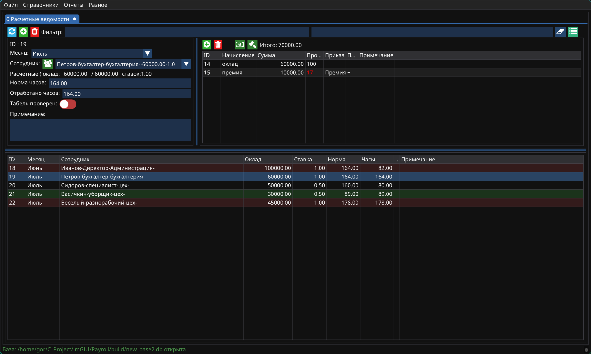
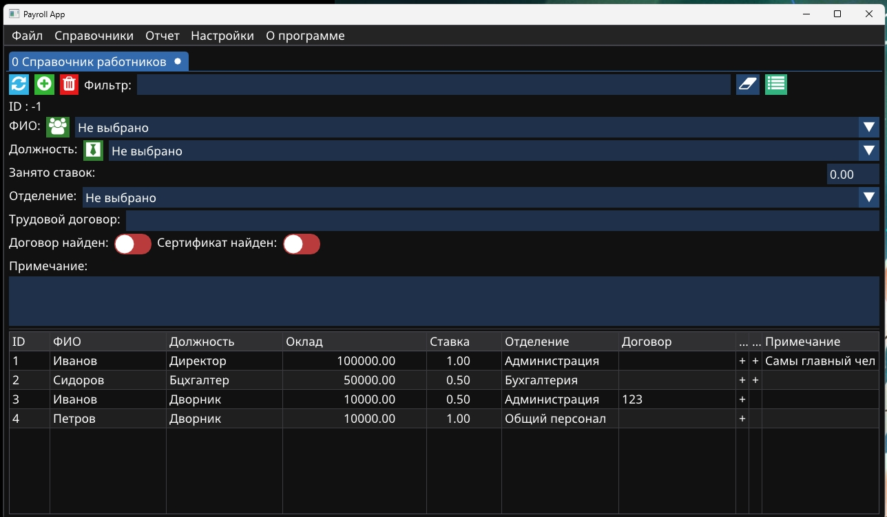

# Аудит начисления заработной платы
Пишем и изучаем IMGUI помаленьку





## настройка зависимостей
Зависимости ImGui и ImGuiFileDialog CMake может скачать автоматически при конфигурации проекта. Если нужна полностью офлайн-сборка, положите их в `thirdparty`:

```bash
git clone -b docking https://github.com/ocornut/imgui.git  thirdparty/imgui
git clone https://github.com/aiekick/ImGuiFileDialog.git thirdparty/ImGuiFileDialog
```

Для сборки также нужна системная библиотека OpenGL. GLFW и SQLite CMake использует из `thirdparty` или скачивает автоматически.

Для полностью офлайн-сборки SQLite можно положить как amalgamation:

```bash
thirdparty/sqlite3/sqlite3.c
thirdparty/sqlite3/sqlite3.h
```

## фонты
fontawesome-webfont.ttf

NotoSans-Regular.ttf

для фонтов https://fontdrop.info/


## для MSYS2
откройте MSYS2 MinGW x64 и выполните:
``` bash
pacman -Syu                          # Обновление системы
pacman -S --needed base-devel        # Базовые инструменты разработки
pacman -S mingw-w64-ucrt-x86_64-toolchain # Компилятор MinGW-w64
pacman -S mingw-w64-ucrt-x86_64-cmake     # CMake для MinGW
pacman -S mingw-w64-ucrt-x86_64-glfw      # GLFW (оконная система для ImGui)
pacman -S mingw-w64-ucrt-x86_64-icu       # для unicode/utf8.h

pacman -S git
```


## Сборка проекта:
``` bash
mkdir build && cd build
cmake ..
```
для MSYS2
``` bash
cmake -G "MinGW Makefiles" ..
```

``` bash
cmake --build . 
```

## Установка в систему
```bash
cmake --install build
```

По умолчанию приложение устанавливается в `/usr/local`: бинарник в `bin`, desktop-файл в `share/applications`, иконка в `share/icons/hicolor/scalable/apps`, шрифты в `share/Payroll/fonts`.

Для установки в другой префикс:
```bash
cmake --install build --prefix /opt/payroll
```


## для релиза
``` bash
cmake -G "MinGW Makefiles" -DCMAKE_BUILD_TYPE=Release ..


make
sudo make install  # Установка в систему

```

## для автономной работы
надо докинуть из каталога msys64\mingw64\bin\ библиотеки:
libwinpthread-1.dll
libgcc_s_seh-1.dll
libstdc++-6.dll
glfw3.dll
libpng16-16.dll
zlib1.dll
